<div align="center">



<br/>

[](https://github.com/IvanMurzak/Context-Engine/actions/workflows/ci.yml)


[-e879f9?style=flat-square)](LICENSE.md)

</div>

**Context** is a C++ game engine built AI-first without making humans second-class. **Project files
are the single source of truth**: a headless project daemon, the **EditorKernel**, keeps a live index
over them, every edit is a file write, and the editor GUI, the `context` CLI and AI agents are equal
clients of one contract. The whole authoring loop runs with no GPU and no GUI.

<p align="center">
  
</p>

> [!WARNING]
> **Pre-alpha.** There are no versioned releases yet: `main` is the only supported line, and things
> change without notice. Milestones M0–M8.5 of the [roadmap](.taskflow/2026-07-01-context-engine/core/ROADMAP.md)
> are done; M9, the interactive editor application, is in progress.

## What is in the repository today

| | |
|---|---|
| **Microkernel + packages** | Every feature is a package: physics (2D and 3D), animation, particles, audio, input, UI, spatial queries, splines |
| **File-authoritative data** | Canonical JSON with stable ids, schema migration (`context migrate`), structural three-way merge (`context merge-file`) |
| **One contract** | Each verb is defined once and projected to a CLI command, an RPC method and an MCP tool definition; `context describe` prints all of it as JSON |
| **Gameplay code** | TypeScript on an embedded V8; a C++/WASM native tier for hot paths |
| **Rendering** | WebGPU, native (wgpu-native) and in the browser (Emscripten); 2D is first-class |
| **Determinism** | Fixed-tick headless sessions, a canonical state hash and replays, checked across Windows, Linux and macOS in CI |
| **Builds** | `context build --target linux \| windows \| macos \| web`, headless |
| **Editor** | A windowed editor (native shell + web UI): dockable panels, command palette, themes, multi-window tear-out |

## Build the engine and the CLI

Needs CMake ≥ 3.25 and a C++20 compiler. No GPU or GUI is required.

```sh
cmake -S src --preset dev
cd src
cmake --build --preset dev
ctest --preset dev --output-on-failure
```

The build lands in `src/build/dev/`, the CLI at `src/build/dev/cli/context`. Other presets:
`deterministic` (strict floating point), `sanitize` (ASan + UBSan) and `tsan` (both non-Windows).

## Use the CLI



```sh
context new my-game                                   # a runnable project skeleton
context describe --json                               # the whole contract as JSON
context session new run.state --seed 7                # a headless deterministic session
context session step run.state --ticks 600 --json     # advance 600 fixed ticks
context session hash run.state --json                 # the canonical state hash
context doctor --target all                           # check the toolchain for every build target
```

Every verb answers with the same envelope (`{"ok": …, "data": …}` or an `error` with a stable
code) when given `--json`. Runnable examples live in [`samples/`](samples/README.md), for instance
the `platformer-2d` and `roll-3d` games; CI keeps every sample valid.

## Build and run the editor

Needs CMake ≥ 3.25 and Python 3; on Windows also Visual Studio with the C++ workload (the editor's
browser shell prebuilt needs MSVC there, clang on Linux and macOS). The script finds the compiler
environment by itself:

```sh
python tools/build_editor.py          # add --no-gpu for the CPU present path (no viewport scene)
src/build/editor/editor/shell/Release/context_editor --project samples/platformer-2d
```

Without `--project` the editor opens its welcome screen. `--devtools` enables the Chromium
DevTools, `--help` lists every option. The editor starts or attaches the project daemon itself.

## Repository layout

| Path | Contents |
|---|---|
| [`src/kernel/`](src/kernel) | The microkernel: the few stable interfaces everything plugs into |
| [`src/editor/`](src/editor) | The EditorKernel daemon, the contract registry, the editor shell and web UI |
| [`src/runtime/`](src/runtime) | The RuntimeKernel: sessions, determinism, V8 and WASM hosts |
| [`src/render/`](src/render) | The WebGPU renderer (native and web) |
| [`src/packages/`](src/packages) | First-party feature packages |
| [`src/cli/`](src/cli) | The `context` CLI |
| [`samples/`](samples/README.md) | Runnable sample projects, checked by CI |
| [`docs/`](docs/README.md) | Engineering notes on how the code implements the design |
| [`.taskflow/`](.taskflow/2026-07-01-context-engine/core) | Design authority: requirements, decisions, architecture, roadmap |

## License

Source-available under the **Context Engine EULA** ([LICENSE.md](LICENSE.md)). The current text is
**draft v0.2 and has not been reviewed by counsel yet**. In short:

- You may use, modify and build the engine to develop games, and ship its runtime inside them.
- Royalty, per product and calendar year: none on the first **$200,000** of gross revenue, then
  **2% of the gross revenue above $200,000**.
- You may not redistribute the engine itself or use its source to build a competing engine or tool.
- It is **not open source**. The license file is the authority; this summary is not.

## Contributing

External pull requests cannot be merged until a CLA exists; see
[CONTRIBUTING.md](.github/CONTRIBUTING.md). Issues, bug reports and design discussion are welcome.
Security reports: [SECURITY.md](SECURITY.md).
